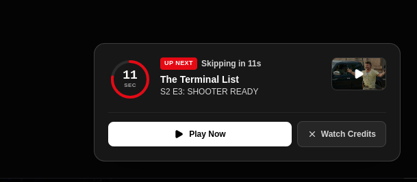

# 🎬 CineTrack 2.0 — Netflix-Quality Desktop Media Center

A production-grade, local streaming platform inspired by Netflix for personal movie and TV series collections on Ubuntu Linux. Powered by **React 19 + TypeScript + Tailwind CSS** frontend with a high-performance **FastAPI + SQLite + libVLC** backend.

[](https://github.com/vamshir21/CineTrack/releases/tag/v2.0.0)
[](https://react.dev/)
[](https://www.typescriptlang.org/)
[](https://fastapi.tiangolo.com/)
[](https://python.org/)
[](https://www.videolan.org/)

---

## 📥 Direct Downloads

Choose the version you want to run:

| Version | Highlights | One-Click Download |
| :--- | :--- | :--- |
| 🚀 **CineTrack 2.0 (Latest)** | Complete Netflix-style rebuild, VLC playback rig, Top 10 rail, 4K badges, Play Something, Library Stats, Permanent Deletion controls | [**⬇️ Download CineTrack v2.0 (.zip)**](https://github.com/vamshir21/CineTrack/archive/refs/tags/v2.0.0.zip) |
| 📦 **CineTrack 1.0 (Classic)** | Original legacy desktop release | [**⬇️ Download CineTrack v1.0 (.zip)**](https://github.com/vamshir21/CineTrack/archive/refs/tags/v1.0.0.zip) |

---

## 🖼️ User Interface Showcase

<!-- ============================================================ -->
<!-- SCREENSHOT 1: HERO & HOME EXPERIENCE                         -->
<!-- ============================================================ -->
### 1. Cinematic Hero Banner & Netflix Rails
*Full-width dynamic backdrop slideshow, left/bottom gradient fusions, carousel indicators, and responsive horizontal rails.*


*(Image Placeholder 1: Place your screenshot at `docs/screenshots/hero_home.png`)*

---

<!-- ============================================================ -->
<!-- SCREENSHOT 2: HOVER CARDS & TOP 10 NUMBERED RAIL            -->
<!-- ============================================================ -->
### 2. Netflix-Style Expanded Hover Cards & Top 10 Rail
*Pixel-perfect viewport-clamped hover expansion with metadata preview, action buttons, progress bars, and authentic Netflix outlined Top 10 ranking numbers.*


*(Image Placeholder 2: Place your screenshot at `docs/screenshots/hover_card_top10.png`)*

---

<!-- ============================================================ -->
<!-- SCREENSHOT 3: NATIVE VLC PLAYBACK & UP-NEXT TIMER           -->
<!-- ============================================================ -->
### 3. Integrated Video Player & Automatic Next Episode Timer
*Native libVLC hardware-accelerated playback with real-time scrub bar, audio/subtitle selectors, and a Netflix-style 10-second countdown prompt before the next episode starts.*


*(Image Placeholder 3: Place your screenshot at `docs/screenshots/player_upnext.png`)*

---

<!-- ============================================================ -->
<!-- SCREENSHOT 4: LIBRARY STATS DASHBOARD & EPISODE MANAGER     -->
<!-- ============================================================ -->
### 4. Executive Library Dashboard & Storage Management
*Glassmorphism metric cards displaying total storage in GB, hours watched, title counts, in-library search/sort, and disk-level permanent file deletion.*


*(Image Placeholder 4: Place your screenshot at `docs/screenshots/library_stats.png`)*

---

## ✨ Features

### 🍿 Authentic Netflix-Style UI / UX
* **Cinematic Hero Carousel:** High-resolution backdrop rotation, focal positioning, gradient vignettes, and one-click playback.
* **Expanded Hover Cards:** Smooth Framer Motion scale-up positioned directly over the hovered card with boundary collision avoidance (never opens off-screen or in the window center).
* **Top 10 Numbered Rail:** Giant outlined SVG ranking glyphs (`1` to `10`) for your library's highest-rated titles.
* **Media Quality & Spec Badges:** Automatic badges (4K UHD, HDR, 5.1 Surround, MKV/MP4) parsed from filenames and media tracks.

### 🎮 Pro Playback Experience
* **Local VLC Engine:** Hardware-accelerated playback with position memory and real-time state synchronization over WebSockets.
* **Smart "Continue Watching":** Tracks exact playback positions; resumes seamlessly or queues the chronological next unwatched episode.
* **"Play Something" Shuffle Mode:** Can't decide what to watch? Press <kbd>S</kbd> or click the Navbar button for instant randomized suggestions with auto-preview.
* **Automatic Next Episode:** Configurable buffer timers prompt a countdown modal before automatically loading the next episode.

### 📦 Library Management & Permanent File Deletion
* **Disk Storage Permanent Deletion:** Delete movies, series, or single episodes from CineTrack with an optional **tick checkbox** to permanently erase the actual video file from system memory (hard drive storage) via `os.remove`.
* **Mark as Watched / Unwatched:** Instant checkmark toggle for entire series, specific seasons, individual episodes, or movies.
* **Executive Statistics Dashboard:** Real-time metrics bar calculating total gigabytes on disk, titles count, completed titles, and hours of watch time.
* **TMDB Metadata Matcher:** Automatic fuzzy title matching with manual search override modal for fixing posters and backdrops.

### ⌨️ Desktop Keyboard Shortcuts
| Key | Action |
| :--- | :--- |
| <kbd>Space</kbd> | Play / Pause video |
| <kbd>F</kbd> | Toggle Fullscreen |
| <kbd>S</kbd> | "Play Something" Shuffle Picker |
| <kbd>/</kbd> | Instant Search |
| <kbd>?</kbd> | Open Shortcuts Help Sheet |
| <kbd>Esc</kbd> | Close Modals / Dismiss Overlays |

---

## 🚀 Quick Start (Ubuntu Linux)

### Prerequisites
Make sure you have Python 3.10+, Node.js 18+, and VLC installed:
```bash
sudo apt update
sudo apt install python3 python3-venv nodejs npm vlc curl
```

### Installation

1. **Clone the repository:**
   ```bash
   git clone https://github.com/vamshir21/CineTrack.git
   cd CineTrack
   ```

2. **Run the one-step setup installer:**
   ```bash
   chmod +x install.sh launch-cinetrack.sh
   ./install.sh
   ```

3. **Configure your TMDB API Key:**
   ```bash
   cp .env.example .env
   nano .env
   # Add your free TMDB v3 API Key:
   # TMDB_API_KEY=your_actual_key_here
   ```

4. **Launch CineTrack:**
   ```bash
   ./launch-cinetrack.sh
   ```
   Open your browser at **`http://localhost:8088`** (or access via your local network).

---

## 🏗️ Architecture

```
CineTrack 2.0
├── frontend/                # React 19 + TypeScript + Vite + Tailwind CSS
│   ├── src/
│   │   ├── api/            # TanStack Query REST clients
│   │   ├── components/     # Cards, Hero, Rails, Modals, VLC Video Rig
│   │   ├── hooks/          # Keyboard shortcuts, hover portals, WebSocket status
│   │   ├── pages/          # Home, Movies, TV Shows, Library (Stats), Search, Settings
│   │   └── types/          # Strict TypeScript interfaces
│   └── dist/               # Production assets served by FastAPI
│
├── backend/                 # Python 3.10+ / FastAPI
│   ├── main.py             # FastAPI ASGI server & SPA static router
│   ├── database.py         # SQLAlchemy engine & SQLite persistence
│   ├── models.py           # Relational schema (Movies, Series, Seasons, Episodes, History)
│   ├── routers/            # Modular APIs (media, playback, scanner, tmdb, watchlist)
│   └── services/           # TMDB image caching, libVLC controller, background scanner
│
└── tests/                   # Automated unittest suite (20/20 test cases passing)
```

---

## 🧪 Testing

Run the full automated test suite:
```bash
./venv/bin/python -m unittest discover tests
```

Run live server integration tests:
```bash
./venv/bin/python test_backend.py
```

---

## 📄 License

Distributed under the **MIT License**. See `LICENSE` for more details.
