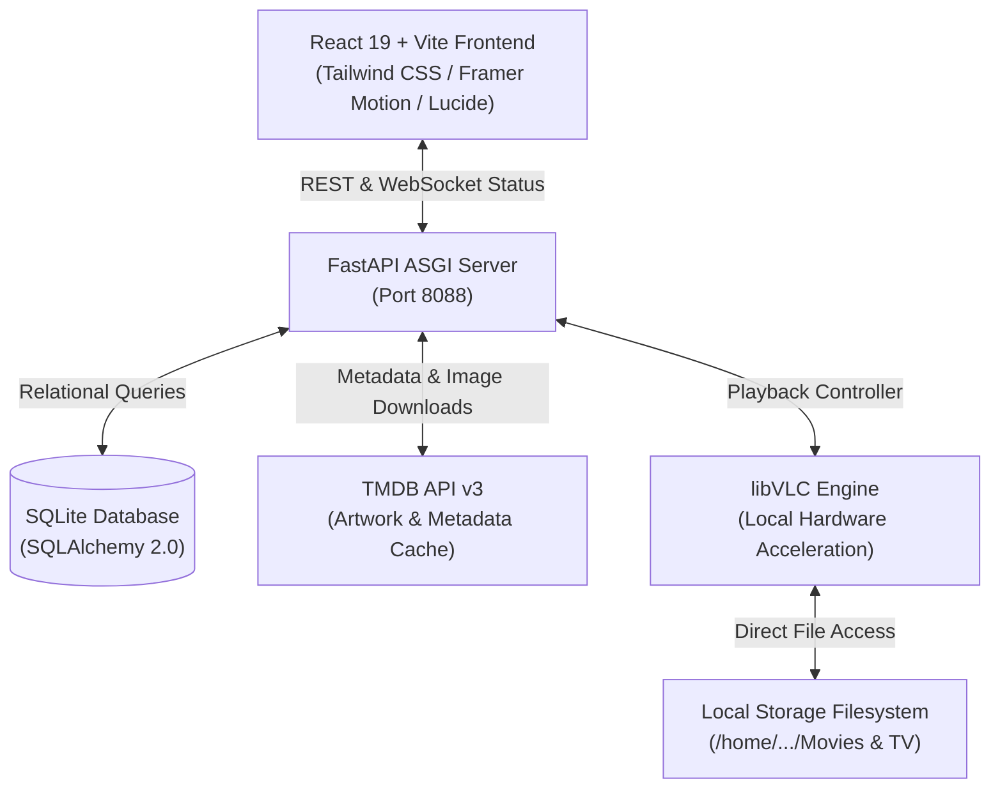

<div align="center">

  

  # CineTrack 2.0
  ### *The Netflix of Local Media.*

  **A production-grade, privacy-first desktop streaming platform that transforms your offline movie and TV collection into an authentic streaming experience.**

  <p align="center">
    <a href="https://github.com/vamshir21/CineTrack/releases/tag/v2.0.0"></a>
    <a href="https://github.com/vamshir21/CineTrack/actions"></a>
    <a href="https://react.dev/"></a>
    <a href="https://fastapi.tiangolo.com/"></a>
    <a href="https://www.videolan.org/"></a>
    <a href="LICENSE"></a>
  </p>

  <p align="center">
    <a href="#-downloads"><strong>Download</strong></a> •
    <a href="#-ui-showcase"><strong>UI Showcase</strong></a> •
    <a href="#-features"><strong>Features</strong></a> •
    <a href="#-why-cinetrack"><strong>Why CineTrack?</strong></a> •
    <a href="#-quick-start"><strong>Quick Start</strong></a> •
    <a href="#-architecture"><strong>Architecture</strong></a> •
    <a href="#-shortcuts"><strong>Keyboard Shortcuts</strong></a>
  </p>

</div>

---

> [!IMPORTANT]
> **100% Local & Private:** CineTrack never streams your videos over external servers or requires a third-party account. All media files stay entirely on your computer, decoded with zero-latency hardware acceleration via native libVLC.

---

## 📥 Downloads

CineTrack is distributed as ready-to-run source archives. Choose your version below:

| Version | Engine & Stack | Key Highlights | Direct Download |
| :--- | :--- | :--- | :---: |
| 🚀 **CineTrack 2.0** <br>*(Latest)* | React 19 · FastAPI · libVLC | Complete Netflix-style rebuild, Top 10 rail, 4K badges, Play Something, Library Stats, Permanent Deletion controls | [**⬇️ Download v2.0.0 (.zip)**](https://github.com/vamshir21/CineTrack/archive/refs/tags/v2.0.0.zip) |
| 📦 **CineTrack 1.0** <br>*(Classic)* | PySide6 / PyQt Desktop Shell | Original legacy release | [**⬇️ Download v1.0.0 (.zip)**](https://github.com/vamshir21/CineTrack/archive/refs/tags/v1.0.0.zip) |

---

## 🖼️ UI Showcase

<div align="center">

### 1. Cinematic Hero Banner & Netflix Rails
*Full-width dynamic backdrop slideshow with focal positioning, smooth gradient overlays, carousel dots, and responsive horizontal rails.*


<sub>*Image Placeholder 1: Place screenshot at `docs/screenshots/hero_home.png`*</sub>

<br><br>

### 2. Netflix-Style Expanded Hover Cards & Top 10 Rail
*Smooth Framer Motion scale-up positioned directly over the hovered card with boundary collision avoidance, metadata previews, action triggers, and authentic outlined Top 10 numbers.*


<sub>*Image Placeholder 2: Place screenshot at `docs/screenshots/hover_card_top10.png`*</sub>

<br><br>

### 3. Native VLC Video Rig & Automatic Up-Next Timer
*Hardware-accelerated libVLC video engine with real-time scrub bar, audio/subtitle selectors, and a Netflix-style 10-second countdown prompt before the next episode starts.*


<sub>*Image Placeholder 3: Place screenshot at `docs/screenshots/player_upnext.png`*</sub>

<br><br>

### 4. Executive Library Dashboard & Storage Management
*Glassmorphism metric cards displaying total storage in GB, hours watched, title counts, in-library search/sort, and disk-level permanent file deletion.*


<sub>*Image Placeholder 4: Place screenshot at `docs/screenshots/library_stats.png`*</sub>

</div>

---

## ⚡ Why CineTrack?

| Capability | **CineTrack 2.0** | **Generic Media Players (VLC / MPV)** | **Heavy Media Servers (Plex / Jellyfin)** |
| :--- | :---: | :---: | :---: |
| **Streaming Platform UX** | **Netflix-Quality** | Basic File Player | Generic Web UI |
| **Playback Latency** | **Instant (Zero Transcode)** | Instant | High (Server Transcoding) |
| **Privacy & Accounts** | **100% Offline / No Account** | 100% Offline | Account & Cloud Dependencies |
| **Native Playback Engine** | **libVLC Hardware Acceleration** | Direct Player | Browser Video / Transcoded HLS |
| **Automatic Next Episode** | **Yes (10s Countdown Timer)** | Manual / Playlist | Yes |
| **Disk Storage Management** | **In-App Permanent Deletion** | Manual File Manager | Complex Permissions |
| **Resource Usage** | **Ultra-Lightweight** | Lightweight | Heavy Background Daemon |

---

## ✨ Core Features

### 🎬 Authentic Streaming Experience
* **Cinematic Hero Carousel:** High-resolution backdrop rotation, focal positioning, gradient vignettes, and one-click playback.
* **Expanded Hover Cards:** Smooth Framer Motion scale-up positioned directly over the hovered card with boundary collision avoidance (never opens off-screen or in the window center).
* **Top 10 Numbered Rail:** Giant outlined SVG ranking glyphs (`1` to `10`) for your library's highest-rated titles.
* **Media Quality & Spec Badges:** Automatic badges (`4K UHD`, `HDR`, `5.1 Surround`, `MKV`/`MP4`) parsed from filenames and media tracks.

### 🎮 Pro Playback Engine
* **Local VLC Engine:** Hardware-accelerated playback with position memory and real-time state synchronization over WebSockets.
* **Smart "Continue Watching":** Tracks exact playback positions; resumes seamlessly or queues the chronological next unwatched episode.
* **"Play Something" Shuffle Mode:** Can't decide what to watch? Press <kbd>S</kbd> or click the Navbar button for instant randomized suggestions with auto-preview.
* **Automatic Next Episode:** Configurable buffer timers prompt a countdown modal before automatically loading the next episode.

### 📦 Library Management & Permanent File Deletion
* **Disk Storage Permanent Deletion:** Delete movies, series, or single episodes from CineTrack with an optional **tick checkbox** to permanently erase the actual video file from system memory (hard drive storage) via `os.remove`.
* **Mark as Watched / Unwatched:** Instant checkmark toggle for entire series, specific seasons, individual episodes, or movies.
* **Executive Statistics Dashboard:** Real-time metrics bar calculating total gigabytes on disk, titles count, completed titles, and hours of watch time.
* **TMDB Metadata Matcher:** Automatic fuzzy title matching with manual search override modal for fixing posters and backdrops.

---

## ⌨️ Desktop Keyboard Shortcuts

| Key | Action | Context |
| :---: | :--- | :--- |
| <kbd>Space</kbd> | Play / Pause video | Video Player |
| <kbd>F</kbd> | Toggle Fullscreen | Video Player |
| <kbd>S</kbd> | Launch "Play Something" Shuffle Picker | Global |
| <kbd>/</kbd> | Instant Library Search Focus | Global |
| <kbd>?</kbd> | Open Keyboard Shortcuts Cheat Sheet | Global |
| <kbd>Esc</kbd> | Close Modal / Player / Drawer | Global |

---

## 🚀 Quick Start (Ubuntu Linux)

### 1. Prerequisites
Ensure you have Python 3.10+, Node.js 18+, and VLC installed:
```bash
sudo apt update && sudo apt install -y python3 python3-venv nodejs npm vlc curl
```

### 2. Clone & Setup
```bash
git clone https://github.com/vamshir21/CineTrack.git
cd CineTrack

# Run the automated installer
chmod +x install.sh launch-cinetrack.sh
./install.sh
```

### 3. TMDB API Key Setup
Get a free API key from [The Movie Database (TMDB)](https://www.themoviedb.org/settings/api) for posters, backdrops, and synopses:
```bash
cp .env.example .env
nano .env
# Set: TMDB_API_KEY=your_tmdb_v3_key
```

### 4. Launch CineTrack
```bash
./launch-cinetrack.sh
```
Open **`http://localhost:8088`** in your browser.

---

## 🏗️ Architecture & Technology Stack



### Technology Breakdown
* **Frontend:** React 19, TypeScript, Vite, Tailwind CSS, Framer Motion, TanStack Query, Lucide Icons
* **Backend:** Python 3.10+, FastAPI, SQLite, SQLAlchemy, Pydantic v2, Uvicorn
* **Playback:** libVLC (via `python-vlc`), WebSocket state telemetry
* **Metadata:** TMDB API v3 with disk image caching in `~/.cinetrack/artwork/`

---

## 🧪 Automated Testing

CineTrack includes an automated unit & regression test suite:

```bash
# Run unit & deletion tests
./venv/bin/python -m unittest discover tests

# Run live API integration tests
./venv/bin/python test_backend.py
```

Expected output:
```text
Ran 20 tests in 0.374s
OK
Results: 14/14 tests passed
```

---

## 🤝 Contributing

Contributions are warmly welcomed!
1. Fork the Project
2. Create your Feature Branch (`git checkout -b feature/AmazingFeature`)
3. Commit your Changes (`git commit -m 'Add some AmazingFeature'`)
4. Push to the Branch (`git push origin feature/AmazingFeature`)
5. Open a Pull Request

---

## 📄 License

Distributed under the **MIT License**. See [`LICENSE`](LICENSE) for more information.

<div align="center">
  <sub>Built with ❤️ by <a href="https://github.com/vamshir21">vamshir21</a></sub>
</div>
