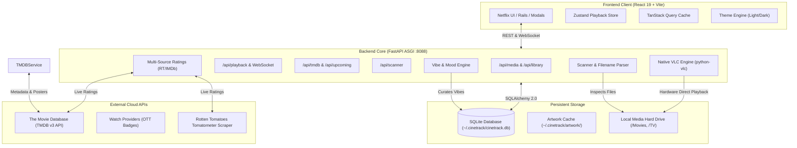
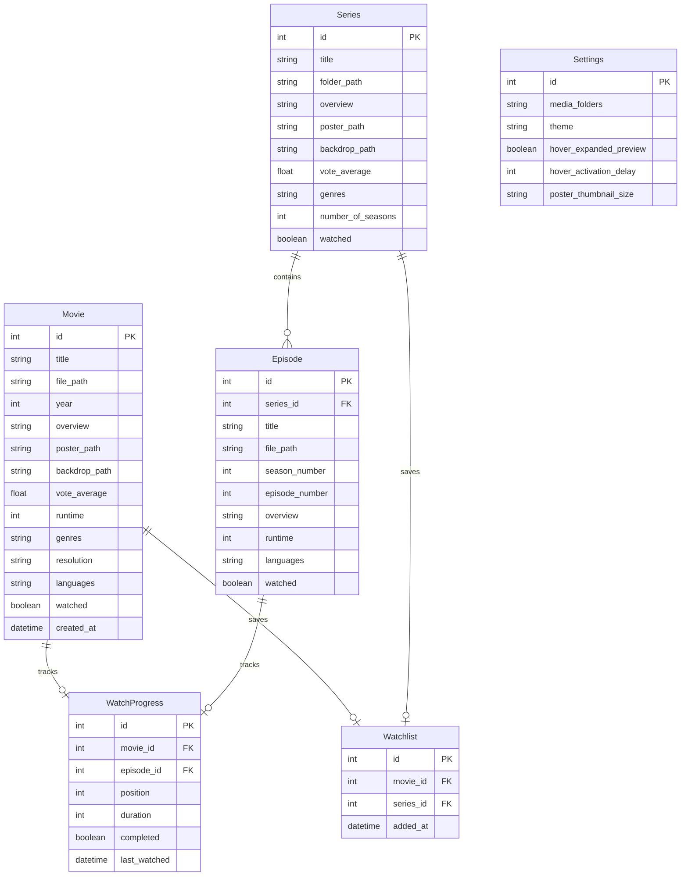
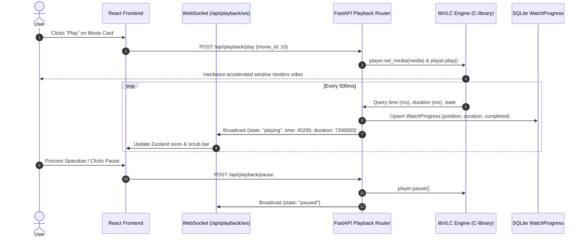

# 🎬 CineTrack 3.0: Complete In-Depth Master Architecture & Developer Guide

> **Welcome to the definitive architectural and engineering deep-dive for CineTrack 3.0.**  
> This guide is designed to help you **master every single layer of CineTrack**—from byte-level video decoding in native libVLC to state-of-the-art React 19 UI interactions, SQLite schemas, asynchronous scraping pipelines, and the mood/discovery recommendation engines.

---

## 📑 Table of Contents
1. [High-Level System Architecture](#1-high-level-system-architecture)
2. [Directory Tree & Responsibility Map](#2-directory-tree--responsibility-map)
3. [The Backend Engine (FastAPI & Python 3.10+)](#3-the-backend-engine-fastapi--python-310)
4. [Database Architecture & SQLAlchemy Models](#4-database-architecture--sqlalchemy-models)
5. [The Playback Engine & Native libVLC Integration](#5-the-playback-engine--native-libvlc-integration)
6. [Library Scanning & Metadata Pipeline](#6-library-scanning--metadata-pipeline)
7. [The Discovery, Vibe & Ratings Subsystems (v3.0)](#7-the-discovery-vibe--ratings-subsystems-v30)
8. [The Frontend Engine (React 19, Vite, Tailwind CSS)](#8-the-frontend-engine-react-19-vite-tailwind-css)
9. [State Management, WebSockets & TanStack Query](#9-state-management-websockets--tanstack-query)
10. [Theme Engine (Light Mode / Dark Mode)](#10-theme-engine-light-mode--dark-mode)
11. [Developer Handbook: How to Extend CineTrack](#11-developer-handbook-how-to-extend-cinetrack)

---

## 1. High-Level System Architecture

CineTrack employs a **Decoupled Desktop-Web Architecture**. Unlike heavy media servers (Plex, Jellyfin) that transcode files into HLS video streams over HTTP, CineTrack pairs a **zero-transcode native playback engine** with a **modern web streaming interface**.



### The Key Technical Differences
1. **Zero Transcoding**: Traditional media servers burn CPU/GPU power converting MKV/x265 to MP4/x264 for web browsers. CineTrack leverages **libVLC directly on the host OS**, decoding any codec, audio track (DTS-HD, TrueHD, 5.1/7.1), or subtitle format (ASS, PGS, SRT) instantly with zero quality loss and zero latency.
2. **Bi-Directional Telemetry**: A WebSocket bridge streams millisecond-level timecodes, pause states, and track indices between native VLC and the React web application in real time.
3. **100% Privacy & Offline First**: Zero cloud accounts required. All library statistics, watch progress, and settings reside in a local SQLite file.

---

## 2. Directory Tree & Responsibility Map

```text
cine/
├── backend/                        # Python FastAPI Backend
│   ├── main.py                     # App entry point, CORS, static mounting, routers
│   ├── database.py                 # SQLite engine, sessionmaker, base model
│   ├── models.py                   # SQLAlchemy ORM relational models
│   ├── schemas.py                  # Pydantic v2 validation schemas
│   ├── config.py                   # Environment variables & ~/.cinetrack paths
│   ├── routers/                    # REST API Endpoint Routers
│   │   ├── media.py                # Movies, series, library stats, vibes, filmography
│   │   ├── playback.py             # Play, pause, seek, stop, WebSocket status
│   │   ├── scanner.py              # Directory scan triggers & progress
│   │   ├── search.py               # In-library keyword search
│   │   ├── settings.py             # App preferences (folders, theme, VLC)
│   │   ├── tmdb.py                 # TMDB match overrides, upcoming releases, ratings
│   │   └── watchlist.py            # User saved titles
│   └── services/                   # Business Logic & Integrations
│       ├── playback_service.py     # Native libVLC instance, state polling, auto-next
│       ├── scanner.py              # Recursive disk scanner, regex parsing
│       ├── tmdb_service.py         # TMDB API v3, OTT providers, franchises
│       ├── ratings_service.py      # IMDb & Rotten Tomatoes scraper
│       ├── vibe_service.py         # Mood categorizer & shuffle algorithms
│       ├── language_service.py     # Audio language extraction
│       └── image_cache.py          # High-speed disk caching for posters/backdrops
│
├── frontend/                       # React 19 + TypeScript + Vite
│   ├── src/
│   │   ├── api/                    # Axios REST client endpoints
│   │   ├── components/             # Reusable UI Modules
│   │   │   ├── cards/              # MediaCard (hover zoom, specs, progress)
│   │   │   ├── common/             # RatingBadges, CastRail, TrailerPlayer
│   │   │   ├── hero/               # HeroSection slideshow banner
│   │   │   ├── layout/             # Navbar (Sun/Moon, Search), Layout container
│   │   │   ├── modals/             # Detail modals, PersonHub, VibeSurprise
│   │   │   ├── player/             # PlayerOverlay & VLC remote control
│   │   │   ├── rails/              # ContentRail, CollectionRail (Franchises)
│   │   │   └── vibe/               # VibeSelector mood drawer & filter
│   │   ├── hooks/                  # Custom hooks (playback, hover, history)
│   │   ├── pages/                  # Route views (Home, Movies, TV, Upcoming, Settings)
│   │   ├── store/                  # Zustand global playback state
│   │   ├── types/                  # TypeScript interfaces matching backend schemas
│   │   ├── utils/                  # Theme, title formatting, language styling
│   │   ├── App.tsx                 # React Router 7 route definitions
│   │   ├── index.css               # Tailwind CSS & Light/Dark mode stylesheets
│   │   └── main.tsx                # React DOM root & TanStack Query provider
│   └── package.json
│
├── tests/                          # Automated Unit & Integration Tests
│   ├── test_deletion_and_stats.py  # Hard drive deletion & executive metrics
│   ├── test_franchises_and_upcoming.py # Collections & OTT discovery
│   └── test_discovery_and_vibes.py # Filmography hub, vibes, ratings
├── install.sh                      # One-click Ubuntu installer
└── launch-cinetrack.sh             # Production launcher script
```

---

## 3. The Backend Engine (FastAPI & Python 3.10+)

### Entry Point: `backend/main.py`
The FastAPI application binds to port `8088`. It performs the following critical tasks at boot:
1. **Database Bootstrap**: Calls `Base.metadata.create_all(bind=engine)` to ensure the SQLite schema and tables exist.
2. **Default Settings Injection**: Ensures initial settings rows (e.g. `theme="dark"`, `hover_delay=300`) exist in the database.
3. **Artwork Static Mount**: Mounts `~/.cinetrack/artwork/` to `/artwork/` so the frontend can load cached high-res posters with fast HTTP 304 caching.
4. **Production Frontend Static Hosting**: Mounts `frontend/dist/` to `/` with a Catch-All SPA fallback returning `index.html` for client-side routing.
5. **WebSocket Endpoint**: Hosts `/api/playback/ws` for bi-directional VLC player telemetry.

---

## 4. Database Architecture & SQLAlchemy Models

CineTrack stores all state in SQLite (`~/.cinetrack/cinetrack.db`) with relational integrity via SQLAlchemy 2.0.



### Relational Highlights
* **Watched Status Cascades**: In `backend/routers/media.py`, when a series is toggled as watched, all associated `Episode` records and their `WatchProgress` rows are marked completed in a single database transaction.
* **Disk-Level Permanent Deletion**: When deleting a title, if `delete_from_disk=True` is passed:
  1. The database row is loaded to obtain `file_path`.
  2. `os.remove(file_path)` deletes the physical file from the hard drive.
  3. For TV shows, all episode files and empty parent folders are removed via `shutil.rmtree`.
  4. The database row and foreign keys cascade delete cleanly.

---

## 5. The Playback Engine & Native libVLC Integration

Located in `backend/services/playback_service.py`, the `PlaybackManager` singleton wraps `python-vlc`.



### Automatic Next Episode Countdown
When `time / duration > 0.98` (or VLC emits `MediaPlayerEndReached`):
1. The playback manager checks if the active item is an `Episode`.
2. It queries SQLite for `season_number == current_season AND episode_number == current_episode + 1`.
3. If found, it emits a WebSocket prompt `{"event": "next_episode_prompt", "next_episode": {...}, "countdown": 10}`.
4. If the user does not cancel, libVLC automatically transitions to the next episode file seamlessly.

---

## 6. Library Scanning & Metadata Pipeline

Located in `backend/services/scanner.py`, the scanner turns raw files into rich cinematic media.

1. **Recursive Traversal**: Scans all directories configured in `Settings.media_folders` for video extensions (`.mp4`, `.mkv`, `.avi`, `.mov`, `.m4v`).
2. **Regex Parsing**:
   - Movie pattern: `^(?P<title>.+?)[._\s(]+(?P<year>(?:19|20)\d{2})`
   - TV pattern: `^(?P<title>.+?)[._\s]+[sS](?P<season>\d{1,2})[eE](?P<episode>\d{1,2})`
3. **Spec Extraction**: Parses video filenames for keywords:
   - Resolution: `2160p`, `4k`, `uhd` → **4K UHD**; `1080p`, `fhd` → **1080p HD**.
   - HDR: `hdr`, `hdr10`, `dolby.vision`, `dv` → **HDR**.
   - Audio: `5.1`, `7.1`, `atmos`, `dts`, `ddp` → **5.1 Surround**.
4. **TMDB Enrichment**:
   - Queries `GET /3/search/movie` or `GET /3/search/tv`.
   - Downloads poster and backdrop to `~/.cinetrack/artwork/{hash}.jpg` for fast offline loading.
   - Saves TMDB ID, overview, vote average, release date, and genre list into SQLite.

---

## 7. The Discovery, Vibe & Ratings Subsystems (v3.0)

### A. Rotten Tomatoes & IMDb Ratings (`backend/services/ratings_service.py`)
Fetches accurate, multi-source critical scores:
* **IMDb**: Queries TMDB `external_ids` to retrieve the IMDb ID (`tt...`), then queries IMDb API / TMDB ratings data for rating value (e.g. `7.9/10`) and vote count.
* **Rotten Tomatoes**: Queries Rotten Tomatoes search endpoints with the title and year to extract:
  - **Tomatometer Critic Score**: Percentage (e.g. `84%`) with fresh 🍅 vs rotten 🟢 icon.
  - **Audience Popcorn Score**: Percentage (e.g. `80%`) with full 🍿 vs tipped bucket icon.
* **Caching**: Ratings are cached in memory with a 24-hour TTL to prevent external rate-limiting.

### B. "Surprise Me by Vibe" Engine (`backend/services/vibe_service.py`)
Classifies local media into 6 psychological viewing moods:
1. `mind_benders`: Sci-Fi, Mystery, Psychological Thrillers (*Inception, Arrival, The Mentalist*).
2. `adrenaline_rush`: War, Survival, Pulse-Pounding Military (*American Sniper, Lone Survivor, Act of Valor*).
3. `crime_thriller`: Gangsters, Detective Noir, Conspiracies (*The Gentlemen, The Mentalist*).
4. `action`: Non-stop high-octane blockbusters (*Jailer, Ranabaali*).
5. `feel_good`: Lighthearted comedy, animation, popcorn adventure.
6. `dystopian`: Apocalyptic survival and harsh futures (*The Hunger Games*).

* **Shuffle API (`/api/library/vibes/surprise`)**: Randomly samples a matching title from your library with full ratings, genre tags, and backdrop, feeding the frontend slot-machine animation.

### C. Actor & Director Filmography Hub (`backend/routers/media.py` & `tmdb_service.py`)
When you click any cast or crew member in the Cast Rail:
1. Calls `/api/library/person/{person_id}/filmography`.
2. Fetches the person's biography, birthday, and complete filmography from TMDB.
3. Cross-references TMDB IDs against the local `Movie` and `Series` SQLite tables.
4. Splits titles into:
   - **"In Your Library"**: Titles you own locally with instant **"Play"** buttons.
   - **"Other Works & Where to Stream"**: Titles you don't own, enriched with JustWatch OTT badges (Netflix, Prime Video, Disney+, Apple TV+) showing where to stream them legally.

### D. Upcoming In-Theaters & OTT Hub (`frontend/src/pages/UpcomingPage.tsx`)
* Tab 1: **In Theaters**: Future cinema releases with days-to-premiere countdowns.
* Tab 2: **Digital & OTT**: Anticipated digital drops across major streaming networks.
* **Global Search**: Search *any* movie in existence (not just local files) to see its synopsis, cast, certification, languages, and which OTT platform has it in your region.

---

## 8. The Frontend Engine (React 19, Vite, Tailwind CSS)

### Routing Architecture (`frontend/src/App.tsx`)
Uses React Router 7 with route transitions:
* `/`: **HomePage** (Hero carousel, Continue Watching, Top 10, Vibes, Genres)
* `/tv`: **TVShowsPage** (Series-specific rails, season pickers)
* `/movies`: **MoviesPage** (Movie-specific rails, duration filters)
* `/upcoming`: **UpcomingPage** (In-Theaters, OTT hub, Global stream finder)
* `/library`: **LibraryPage** (Executive stats dashboard, storage management, delete)
* `/watchlist`: **WatchlistPage** (Bookmarked titles)
* `/settings`: **SettingsPage** (Folders, theme mode, hover card tuning)

### Component Hierarchy
```text
Layout
├── Navbar (Logo, NavLinks, Search, ThemeToggle, PlaySomething, Settings)
├── HeroSection (Dual-row metadata, rating badges, cinematic backdrop)
├── ContentRail (Framer Motion horizontal scroll, numbered Top 10 glyphs)
│   └── MediaCard (Fluid width, video specs, language badges, hover zoom drawer)
├── VibeSelector (Curated mood buttons, expanded 6-card rail, Surprise Me modal)
├── CastRail (Actor & Director portraits, click-to-open filmography hub)
└── Modals (MovieDetailModal, SeriesDetailModal, PersonDetailModal, VibeSurpriseModal)
```

---

## 9. State Management, WebSockets & TanStack Query

* **Server State**: Managed entirely by **TanStack Query (React Query)**. Queries like `useQuery(['library', 'home'])` handle background cache invalidation, loading skeletons, and error boundaries.
* **Playback State**: Managed by **Zustand** in `frontend/src/store/playbackStore.ts`.
* **Real-time Telemetry**: `frontend/src/hooks/usePlayback.ts` establishes a WebSocket to `ws://localhost:8088/api/playback/ws`. When VLC changes state, Zustand updates without triggering unnecessary React component tree re-renders.

---

## 10. Theme Engine (Light Mode / Dark Mode)

CineTrack supports both **Cinematic Dark** (`#141414`) and **Clean Light** (`#f8fafc`):

1. **Storage & Persistence (`frontend/src/utils/themeUtils.ts`)**:
   - Key: `cinetrack_theme` in `localStorage`.
   - Also syncs to backend SQLite `Settings.theme` via `PUT /api/settings`.
2. **Instant Event Dispatch**:
   - Triggers `window.dispatchEvent(new CustomEvent('cinetrack_theme_changed'))`.
   - The Navbar Moon/Sun icon updates instantly on all open tabs.
3. **Hero Contrast Safeguard**:
   - Scoped CSS rules in `frontend/src/index.css` under `.hero-container` guarantee that hero banner typography, Play button, and rating badges retain high contrast against dark photographic backdrops even when the rest of the application is in Light Mode.

---

## 11. Developer Handbook: How to Extend CineTrack

### How to Add a New API Route
1. Open or create a file in `backend/routers/` (e.g., `backend/routers/custom.py`).
2. Define your endpoint:
   ```python
   from fastapi import APIRouter, Depends
   from sqlalchemy.orm import Session
   from backend.database import get_db

   router = APIRouter(prefix="/api/custom", tags=["custom"])

   @router.get("/hello")
   def get_hello(db: Session = Depends(get_db)):
       return {"message": "Hello from CineTrack!"}
   ```
3. Register the router in `backend/main.py`:
   ```python
   from backend.routers import custom
   app.include_router(custom.router)
   ```

### How to Add a Frontend API Call & Hook
1. Add the function in `frontend/src/api/`:
   ```typescript
   export const fetchCustomHello = async () => {
     const res = await apiClient.get('/api/custom/hello');
     return res.data;
   };
   ```
2. Consume it in any React component via TanStack Query:
   ```typescript
   const { data, isLoading } = useQuery({
     queryKey: ['customHello'],
     queryFn: fetchCustomHello,
   });
   ```

### How to Run Tests
```bash
# Backend unit & regression tests
./venv/bin/python -m unittest discover tests

# Frontend production type-check & build
npm --prefix frontend run build
```

---

*Authored for the CineTrack engineering team. Keep this guide handy as you build LAN storage, multi-user profiles, and cross-device synchronization in CineTrack 4.0!*
