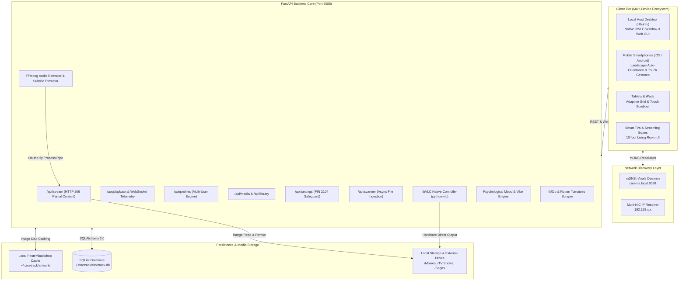
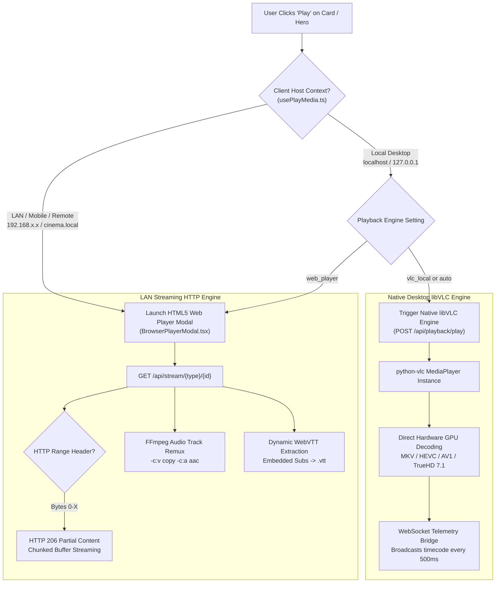
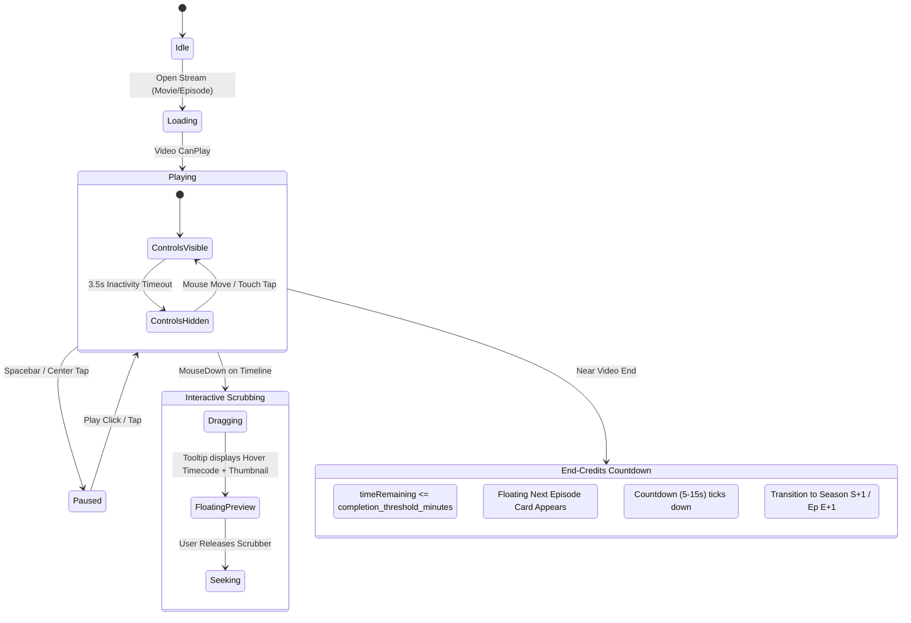
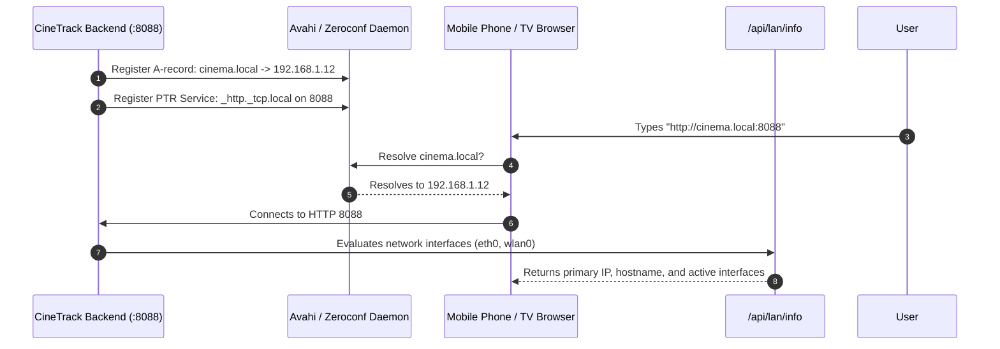
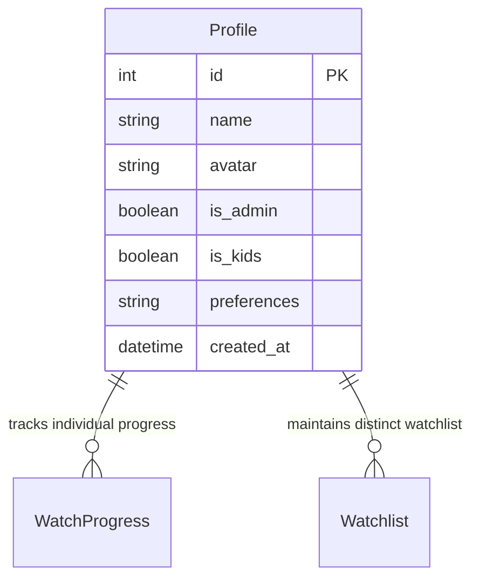
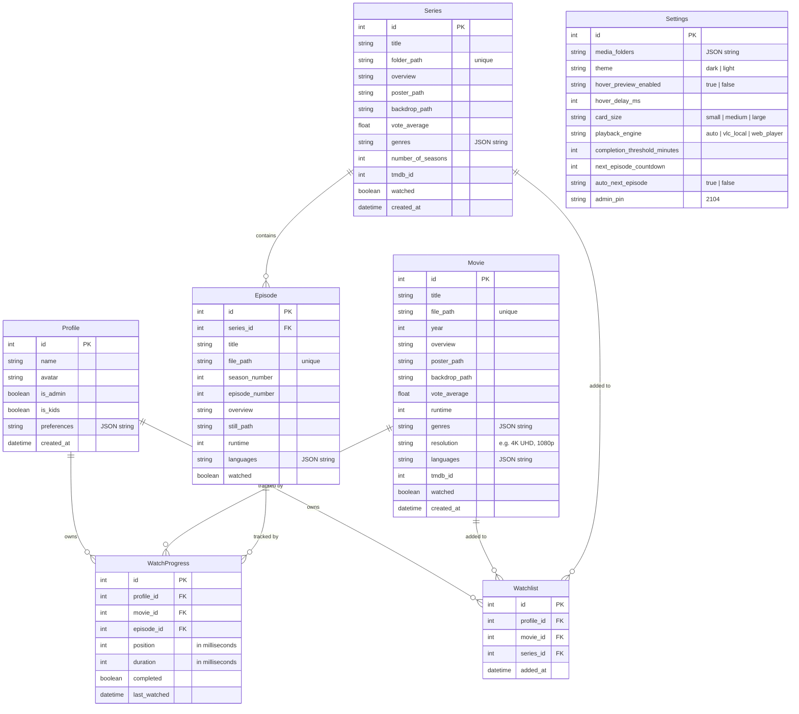
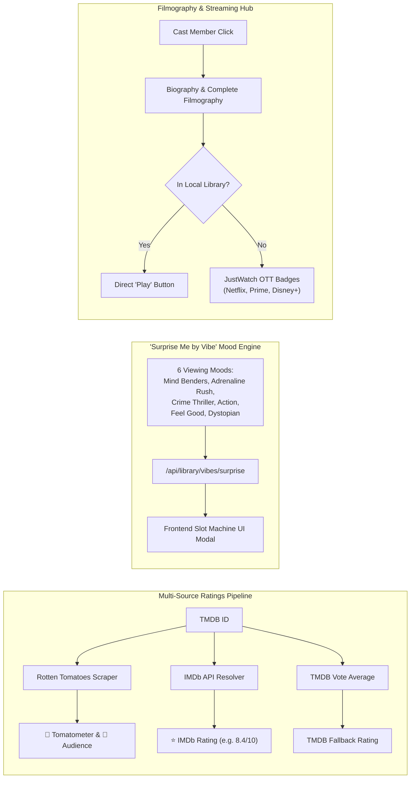
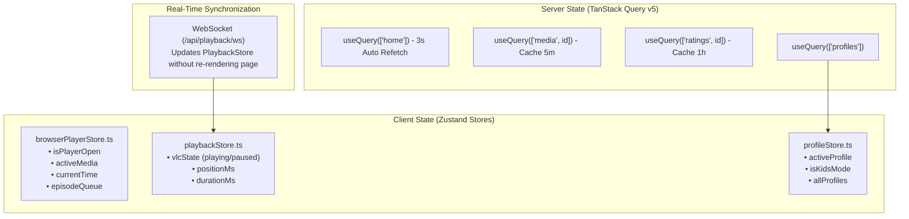

# 🎬 CineTrack 4.0: Complete In-Depth Master Architecture & Developer Guide

> **The Definitive Engineering & Architectural Blueprint for CineTrack 4.0**  
> CineTrack is an open-source, ultra-responsive, zero-transcode local media center and LAN streaming platform. It transforms personal video collections into a private, high-fidelity streaming service modeled after Netflix, pairing direct-hardware desktop decoding with range-request LAN streaming, multi-user profiles, admin safeguards, and psychological discovery engines.

---

## 📑 Table of Contents
1. [Executive Summary & Architectural Philosophy](#1-executive-summary--architectural-philosophy)
2. [High-Level System & Network Architecture](#2-high-level-system--network-architecture)
3. [Directory Tree & Complete Codebase Inventory](#3-directory-tree--complete-codebase-inventory)
4. [Dual Playback Architecture: libVLC vs. HTML5 Range Streaming](#4-dual-playback-architecture-libvlc-vs-html5-range-streaming)
5. [The Web Media Player Engine (Netflix-Grade Web Experience)](#5-the-web-media-player-engine-netflix-grade-web-experience)
6. [LAN Networking, mDNS & Multi-NIC Subsystems](#6-lan-networking-mdns--multi-nic-subsystems)
7. [Multi-Profile System & Kids Isolation](#7-multi-profile-system--kids-isolation)
8. [Admin Security, 2104 PIN Protection & Disk Safeguards](#8-admin-security-2104-pin-protection--disk-safeguards)
9. [Database Schema & Relational Models (SQLAlchemy 2.0)](#9-database-schema--relational-models-sqlalchemy-20)
10. [Media Ingestion, Scanning & Metadata Pipeline](#10-media-ingestion-scanning--metadata-pipeline)
11. [Discovery, Vibe & Multi-Source Ratings Subsystems](#11-discovery-vibe--multi-source-ratings-subsystems)
12. [Frontend Architecture: React 19, Motion & Adaptive Rails](#12-frontend-architecture-react-19-motion--adaptive-rails)
13. [State Management, WebSockets & TanStack Query](#13-state-management-websockets--tanstack-query)
14. [Theme Engine (Cinematic Dark & Clean Light)](#14-theme-engine-cinematic-dark--clean-light)
15. [Exhaustive REST API & WebSocket Specification](#15-exhaustive-rest-api--websocket-specification)
16. [Developer Handbook: Running, Testing & Extending CineTrack](#16-developer-handbook-running-testing--extending-cinetrack)

---

## 1. Executive Summary & Architectural Philosophy

### The Media Center Dilemma
Traditional media servers (Plex, Emby, Jellyfin) were engineered for centralized server racks: they force the host machine to transcode high-bitrate video (HEVC, AV1, 4K HDR) into lower-bitrate HLS streams over HTTP, burning enormous CPU/GPU wattage and causing audio sync drift, washed-out HDR colors, and dropped frames. Conversely, desktop video players (VLC, MPV) provide immaculate hardware decoding but lack modern streaming interfaces, cover-art discovery, progress tracking across devices, and multi-user profile isolation.

### The CineTrack 4.0 Solution
CineTrack bridges this divide through a **Decoupled Desktop-LAN Hybrid Architecture**:
* **On the Local Host (Ubuntu Desktop)**: CineTrack leverages native `libVLC` via hardware direct bitstream pass-through. It decodes any file (MKV, MP4, AVI, WebM) at native bitrates with zero transcoding, zero latency, and zero loss of HDR dynamic range or lossless DTS-HD / Dolby TrueHD 7.1 audio.
* **Across the LAN (Smartphones, Tablets, Laptops, Smart TVs)**: CineTrack acts as a high-performance HTTP media server supporting HTTP 206 Partial Content byte-range streaming, on-the-fly AAC audio remuxing, dynamic WebVTT subtitle extraction, and full remote progress synchronization.
* **100% Privacy & Zero Cloud Dependency**: No Plex accounts, no tracking telemetry, no cloud relays. Everything—database, artwork cache, user profiles, and settings—lives strictly on the local machine in `~/.cinetrack/`.

---

## 2. High-Level System & Network Architecture



---

## 3. Directory Tree & Complete Codebase Inventory

```text
cine/
├── backend/                                # FastAPI Python 3.10+ ASGI Backend
│   ├── config.py                           # Paths, environment variables, ~/.cinetrack definitions
│   ├── database.py                         # SQLite engine, sessionmaker, declarative base
│   ├── main.py                             # App lifecycle, CORS, static routes, router registration
│   ├── models.py                           # SQLAlchemy 2.0 ORM relational models
│   ├── schemas.py                          # Pydantic v2 validation & response contracts
│   ├── routers/                            # REST API Endpoints
│   │   ├── lan.py                          # Network detection, host IP discovery, connection info
│   │   ├── media.py                        # Movies, series, episodes, collections, filmography, stats
│   │   ├── playback.py                     # VLC controls (play, pause, seek), audio/subs tracks, WS
│   │   ├── profiles.py                     # Multi-profile CRUD, kids toggles, avatar management
│   │   ├── scanner.py                      # Background directory traversal & scan progress
│   │   ├── search.py                       # High-speed keyword search across movies, series, cast
│   │   ├── settings.py                     # System preferences, admin PIN verification (2104)
│   │   ├── stream.py                       # HTTP 206 video streaming, audio remuxing, WebVTT extraction
│   │   ├── tmdb.py                         # TMDB API v3 gateway, upcoming cinema, OTT availability
│   │   └── watchlist.py                    # Per-profile saved watchlist management
│   └── services/                           # Domain Services & Business Logic
│       ├── image_cache.py                  # High-speed SHA256 disk caching for artwork
│       ├── language_service.py             # Audio language stream identification & badges
│       ├── mdns_service.py                 # Zeroconf & Avahi mDNS announcer (cinema.local)
│       ├── playback_service.py             # Native libVLC wrapper, state polling, timecode broadcasting
│       ├── ratings_service.py              # Multi-source scraper (Rotten Tomatoes, IMDb, TMDB)
│       ├── scanner.py                      # Regex media parser, resolution/HDR/audio spec extractor
│       ├── tmdb_service.py                 # Metadata fetching, actor credits, movie collections
│       └── vibe_service.py                 # 6-tier psychological mood categorizer & shuffle engine
│
├── frontend/                               # React 19 + TypeScript + Vite Client Application
│   ├── src/
│   │   ├── api/                            # Axios API Service Modules
│   │   │   ├── client.ts                   # Axios instance, baseURL, X-Profile-ID injection
│   │   │   ├── lan.ts                      # LAN IP endpoints
│   │   │   ├── library.ts                  # Media library, home feed, stats endpoints
│   │   │   ├── playback.ts                 # VLC playback endpoints
│   │   │   ├── profiles.ts                 # Profile management endpoints
│   │   │   ├── settings.ts                 # System settings & PIN verification
│   │   │   ├── stream.ts                   # Stream URL helpers, audio tracks, WebVTT tracks
│   │   │   ├── tmdb.ts                     # TMDB discovery, trailers, ratings
│   │   │   └── watchlist.ts                # Watchlist endpoints
│   │   ├── components/                     # Modular Reusable UI Components
│   │   │   ├── cards/                      # MediaCard (hover zoom drawer, video specs, progress bar)
│   │   │   ├── common/                     # RatingBadges, CastRail, TrailerPlayer, ImageWithFallback
│   │   │   ├── hero/                       # HeroSection (cinematic slideshow, audio toggles, badges)
│   │   │   ├── layout/                     # Navbar, MobileBottomNav, Layout root container
│   │   │   ├── modals/                     # Detail modals (Movie, Series), PersonHub, LanConnectModal
│   │   │   ├── player/                     # BrowserPlayerModal (rich web player), PlayerOverlay (VLC HUD)
│   │   │   ├── profiles/                   # ProfileSelectorModal (avatar picker, kids mode, PIN badge)
│   │   │   ├── rails/                      # ContentRail (adaptive scroll), CollectionRail (franchises)
│   │   │   └── vibe/                       # VibeSelector (mood pills, 6-card drawer, Surprise Me modal)
│   │   ├── hooks/                          # Custom React Hooks
│   │   │   ├── usePlayback.ts              # WebSocket listener for VLC real-time telemetry
│   │   │   └── usePlayMedia.ts             # Smart player dispatcher (VLC desktop vs Web player LAN)
│   │   ├── pages/                          # Primary Route Views
│   │   │   ├── HomePage.tsx                # Hero carousel, Continue Watching, Top 10, Mood Rails
│   │   │   ├── LibraryPage.tsx             # Executive storage dashboard, disk cleanup, batch mark
│   │   │   ├── MoviesPage.tsx              # Grid view, duration filters, genre dropdown
│   │   │   ├── SearchPage.tsx              # Instant live search across library & global TMDB
│   │   │   ├── SettingsPage.tsx            # Folders, Admin PIN authentication, playback engine, LAN IP
│   │   │   ├── TVShowsPage.tsx             # Series rail, episode list drawer, season navigator
│   │   │   ├── UpcomingPage.tsx            # Theatrical release calendar, OTT streaming releases
│   │   │   └── WatchlistPage.tsx           # Bookmarked titles for the active profile
│   │   ├── store/                          # Zustand State Stores
│   │   │   ├── browserPlayerStore.ts       # HTML5 player modal state, active stream, episode queue
│   │   │   ├── playbackStore.ts            # Native VLC state, scrub position, volume, playback state
│   │   │   └── profileStore.ts             # Active profile, profile list, avatar selector state
│   │   ├── types/                          # Comprehensive TypeScript Interfaces
│   │   ├── utils/                          # Formatting, media badges, language styles, theme utilities
│   │   ├── App.tsx                         # React Router 7 setup & global modal registration
│   │   ├── index.css                       # Tailwind CSS directives, theme styling, scrollbar reset
│   │   └── main.tsx                        # React DOM root & TanStack React Query provider
│   ├── package.json                        # Dependencies, build scripts
│   └── vite.config.ts                      # Vite build configuration, proxy rules
│
├── tests/                                  # Automated Test Suite (41 Unit & Integration Tests)
│   ├── test_cinetrack.py                   # Core library, routes, and baseline endpoints
│   ├── test_deletion_and_stats.py          # Hard drive file deletion, cascade cleanup, stats logic
│   ├── test_discovery_and_vibes.py         # Filmography hub, mood shuffle, ratings integration
│   ├── test_franchises_and_upcoming.py     # Movie collections, theatrical countdowns, OTT badges
│   └── test_lan_and_profiles.py            # Stream range requests, profile isolation, admin PIN rules
├── install.sh                              # Automated Ubuntu installer (VLC, Python, Node, FFmpeg)
├── launch-cinetrack.sh                     # Production service manager & background runner
└── docs/
    └── MASTER_ARCHITECTURE_GUIDE.md        # This comprehensive document
```

---

## 4. Dual Playback Architecture: libVLC vs. HTML5 Range Streaming

A hallmark feature of CineTrack 4.0 is its **intelligent dual-engine playback architecture**. CineTrack automatically identifies whether the consumer is sitting at the host computer or accessing the application over the local Wi-Fi network.



### 1. The Native libVLC Engine (`backend/services/playback_service.py`)
* **When Activated**: When browsing CineTrack locally on the Ubuntu host machine via `http://localhost:8088` or `http://127.0.0.1:8088`.
* **Zero Overhead**: Directly launches a native window or integrates into the desktop viewport. Decoding happens inside the C-based libVLC core, completely bypassing browser codec limitations.
* **Format Universal**: Plays lossless Dolby Atmos, DTS-HD Master Audio, multichannel FLAC, 10-bit HDR10+, and stylized ASS subtitles with full typography without touching the CPU.
* **WebSocket Bridge (`/api/playback/ws`)**: Sends JSON packets containing `{state: "playing", time: 42100, duration: 6840000, volume: 85}` every 500ms to keep the browser HUD synchronized.

### 2. The LAN Web Streaming Engine (`backend/routers/stream.py`)
* **When Activated**: When connecting from mobile phones, tablets, smart TVs, or remote laptops via `http://cinema.local:8088` or `http://192.168.x.x:8088`.
* **HTTP 206 Byte-Range Streaming**: Enables instantaneous scrubbing and seeking. Browsers request specific byte offsets (`Range: bytes=1048576-2097151`); the server streams exactly those bytes from disk using asynchronous Python generators.
* **Lossless Video Remuxing**: Uses `-c:v copy` so the original video bitrate and resolution are preserved untouched without CPU transcoding.
* **Dynamic Audio Remuxing**: When the browser cannot natively decode DTS or AC3 audio, CineTrack pipes the audio stream through FFmpeg on-the-fly (`-c:a aac -b:a 256k`), preserving crystal-clear audio with near-zero latency.
* **Dynamic WebVTT Subtitle Extraction**: Extracts internal subtitle tracks directly into clean WebVTT format served over `/api/playback/subtitle/{type}/{id}/{track_index}.vtt`.

---

## 5. The Web Media Player Engine (Netflix-Grade Web Experience)

The web player (`frontend/src/components/player/BrowserPlayerModal.tsx`) is a 1,600+ line custom media suite matching the standard of major commercial streaming services.



### Key Technical Capabilities:
1. **Centered Control Suite**:
   * Massive center Play/Pause toggle with smooth scale and spring physics.
   * Prominent -10s rewind and +10s fast-forward buttons.
2. **Mobile Touch & Gestures**:
   * **Double-Tap Left**: Seeks backward 10 seconds accompanied by a pulsating circular ripple animation and numeric "-10s" indicator.
   * **Double-Tap Right**: Seeks forward 10 seconds with forward ripple animation.
   * **Single Tap**: Toggles HUD controls with a 3.5-second auto-hide inactivity timer.
3. **Landscape Auto-Lock**:
   * On mobile devices, launching the player requests native fullscreen via `element.requestFullscreen()` and locks the viewport orientation to landscape using `screen.orientation.lock('landscape')`.
   * When exiting playback, the orientation lock is released gracefully.
4. **Interactive Scrubber with Hover Timecode & Preview**:
   * Real-time draggable timeline tracking buffered progress vs. current playback position.
   * Floating preview tooltip calculates the hovered timecode relative to cursor position and renders a thumbnail preview box.
5. **Audio & Subtitle Track Selector**:
   * Modal drawer allowing users to switch between multiple embedded audio languages and subtitle tracks on the fly.
6. **Smart Next Episode & End-Credits Automation**:
   * Integrated **"Next Episode" button** with `SkipForward` icon in both the center control deck and the bottom control bar (also mapped to key `N`).
   * **Settings-Driven Countdown**: Reads `completion_threshold_minutes` (triggering the popup when remaining time is under the threshold), displays a customizable `next_episode_countdown` (5–15 seconds), and automatically starts the next episode if `auto_next_episode` is enabled.
7. **System Brightness & Volume Integration**:
   * Artificial software CSS filters were removed in favor of clean hardware-integrated volume sliders, avoiding visual banding or washed-out black levels.

---

## 6. LAN Networking, mDNS & Multi-NIC Subsystems

To make home streaming zero-configuration, CineTrack 4.0 integrates automatic local name resolution and multi-NIC detection.



### 1. The mDNS Announcer (`backend/services/mdns_service.py`)
* CineTrack invokes `avahi-publish -a -R cinema.local <LAN_IP>` or falls back to Python's `zeroconf` library.
* Allows any device on your Wi-Fi router (iPhones, Androids, MacBooks, Windows PCs) to access the library by navigating to **`http://cinema.local:8088`** without memorizing changing local IP addresses.

### 2. Multi-NIC IP Resolution (`backend/routers/lan.py`)
* Dynamically scans active network interfaces (`wlan0`, `eth0`, `enp3s0`), filtering out loopback (`127.0.0.1`) and virtual container bridges (`docker0`).
* Surfaces the primary routable LAN IP to the frontend **Settings** and **LAN Connect Modal** (`LanConnectModal.tsx`).
* Provides a **one-click copy button** with instant clipboard integration and toast feedback.

---

## 7. Multi-Profile System & Kids Isolation

CineTrack supports personalized multi-user profiles stored in the SQLite `Profile` table.



### 1. Profile Architecture & State Isolation
* **Client Store (`frontend/src/store/profileStore.ts`)**: The selected profile is persisted in `localStorage`.
* **API Ingestion (`frontend/src/api/client.ts`)**: Every outgoing Axios HTTP request automatically attaches the header:
  ```http
  X-Profile-ID: <active_profile_id>
  ```
* **Independent Watch Progress**: Profile "Vamshi" and Profile "Kids" have isolated `WatchProgress` rows. When Vamshi finishes an episode, it does not mark it as watched for the Kids profile.
* **Independent Watchlists**: Bookmarking a movie only attaches it to the current user's profile ID.

### 2. Kids Mode Protection
* When `is_kids == True`:
  1. The backend automatically injects content rating filters into all catalog and search queries.
  2. Only titles with certifications `G`, `PG`, `TV-Y`, `TV-Y7`, or `TV-G` are returned.
  3. All R-rated, NC-17, and TV-MA movies/series are strictly hidden from the home rails, search results, and recommendations.

---

## 8. Admin Security, 2104 PIN Protection & Disk Safeguards

To prevent house guests or children from inadvertently deleting files or tampering with server settings, CineTrack enforces **Admin PIN Protection**.

```mermaid
flowchart TD
    Action["User attempts Restricted Action:<br/>• Permanent Disk Deletion<br/>• Rescan Media Library<br/>• Add/Remove Media Folders<br/>• Change Playback Settings"] --> CheckProfile{"Is Active Profile Admin?"}
    
    CheckProfile -->|No (Regular / Kids)| DenyAction["403 Forbidden<br/>'Admin Privileges Required'"]
    CheckProfile -->|Yes (Admin Profile)| PromptPIN["Display AdminPinModal.tsx<br/>Enter 4-digit PIN"]
    
    PromptPIN --> EnterPIN["User inputs PIN"]
    EnterPIN --> VerifyAPI["POST /api/settings/verify-pin<br/>{pin: '2104'}"]
    
    VerifyAPI -->|Incorrect PIN| ShakeModal["Vibrate Input / Display Error<br/>'Invalid Admin PIN'"]
    VerifyAPI -->|PIN == 2104| ExecuteAction["Execute Destructive Action<br/>Permanent Disk Delete / Config Change"]
```

### Security Rules:
1. **Master Admin PIN**: Hardcoded to **`2104`**.
2. **Read-Only Non-Admin Profiles**: Non-admin users can stream, browse, search, and manage their personal watch progress and watchlist. They **cannot** delete movies, trigger library scans, or alter configuration.
3. **Permanent File Deletion Safeguard**:
   * Deleting a title with `delete_file=true` checks admin authorization.
   * When authenticated, `backend/routers/media.py` removes the physical media from the disk (`os.remove` or `shutil.rmtree`) and cascades deletes through `WatchProgress`, `Watchlist`, and `Episode` tables.

---

## 9. Database Schema & Relational Models (SQLAlchemy 2.0)

All persistent state is managed via SQLite located at `~/.cinetrack/cinetrack.db`.



---

## 10. Media Ingestion, Scanning & Metadata Pipeline

Located in `backend/services/scanner.py`, the ingestion pipeline handles raw file organization:

1. **Directory Traversal**: Scans all paths in `Settings.media_folders` for video files (`.mp4`, `.mkv`, `.avi`, `.mov`, `.m4v`, `.webm`).
2. **Regex Parsing Engine**:
   * **Movies**: Identifies titles and release years:
     ```regex
     ^(?P<title>.+?)[._\s(]+(?P<year>(?:19|20)\d{2})
     ```
   * **TV Episodes**: Identifies series title, season, and episode numbers:
     ```regex
     ^(?P<title>.+?)[._\s]+[sS](?P<season>\d{1,2})[eE](?P<episode>\d{1,2})
     ```
3. **Hardware Spec Extraction**:
   * Parses filenames and video stream headers for quality badges:
     * **Resolution**: `2160p`, `4k`, `uhd` → `4K UHD`; `1080p` → `1080p HD`.
     * **Color Space**: `hdr`, `hdr10`, `dolby.vision`, `dv` → `HDR` / `DV`.
     * **Audio Channels**: `5.1`, `7.1`, `atmos`, `dts`, `ddp` → `5.1 Surround`.
4. **TMDB Enrichment & Local Caching**:
   * Calls TMDB v3 API to fetch official high-resolution posters and backdrops.
   * Hashes and saves artwork locally to `~/.cinetrack/artwork/{hash}.jpg` so the UI functions seamlessly even when offline.

---

## 11. Discovery, Vibe & Multi-Source Ratings Subsystems



### 1. Multi-Source Critical Ratings (`backend/services/ratings_service.py`)
* Renders real-world critical consensus badges side by side:
  * **Rotten Tomatoes Critic Score**: Official Tomatometer percentage with fresh 🍅 vs rotten 🟢 icon.
  * **Rotten Tomatoes Audience Score**: Popcorn score with full 🍿 vs spilled bucket icon.
  * **IMDb Rating**: Star score (e.g., `8.2/10`) with vote count.
  * In-memory 24-hour TTL caching prevents external API throttling.

### 2. "Surprise Me by Vibe" Engine (`backend/services/vibe_service.py`)
Classifies the entire library into 6 psychological moods:
* `mind_benders`: Sci-Fi, Psychological Thrillers, Mysteries.
* `adrenaline_rush`: Military Survival, War, Intense Action.
* `crime_thriller`: Detective Noir, Mafia, Conspiracies.
* `action`: High-octane blockbusters.
* `feel_good`: Lighthearted comedy, animation, family adventures.
* `dystopian`: Post-apocalyptic survival, alternate realities.

### 3. Actor & Director Filmography Hub
* Clicking any portrait in the Cast Rail opens the **Person Hub**.
* Splits the actor's or director's career into:
  1. **"In Your Library"**: Titles available on your hard drives, ready to play instantly.
  2. **"Other Works & Where to Stream"**: Titles not in your collection, tagged with JustWatch streaming provider badges (Netflix, Prime Video, Apple TV, Disney+).

---

## 12. Frontend Architecture: React 19, Motion & Adaptive Rails

### 1. Responsive Multi-Device Rail System
The frontend dynamically computes card geometry across screen sizes:
* **Mobile Phones (< 640px)**:
  * Uses fixed touch widths (135px poster / 210px backdrop).
  * Hover preview expansion is disabled to allow smooth native vertical scrolling and one-tap playback.
  * Sticky **Mobile Bottom Navigation Bar** (`MobileBottomNav.tsx`).
* **Desktop & Large Displays (≥ 640px)**:
  * **Posters (2:3)**: Base width ~200px; expands on hover to **`380px`**.
  * **Backdrops (16:9 - Continue Watching)**: Base width ~295px; expands on hover to **`375px–410px`**.
  * **Smooth Row Shift**: Neighboring cards slide left and right (`translateX`) to create physical space for the enlarged card.

### 2. Zero-Clipping Vertical Layout Architecture
In prior releases, hovering over cards in the **Continue Watching** rail clipped the bottom drawer because of standard CSS `overflow-x: auto` boundaries. CineTrack 4.0 solves this via mathematical coordinate centering:

```mermaid
graph TD
    ScrollContainer["ContentRail Scroll Container (overflow-x-auto)"]
    
    subgraph PaddingBox["Variant-Aware Padding Box"]
        ContainerTop["Container Top Edge (y = 0)"]
        PaddingTop["pt-16 (64px)"]
        BaseCard["Base Card Slot (16:9 Backdrop = 166px Height)"]
        PaddingBottom["pb-56 (224px)"]
        ContainerBottom["Container Bottom Edge (Total Height = 454px)"]
    end
    
    subgraph HoverCard["Hover Card Centering (MediaCard.tsx)"]
        CardTop["Expanded Card Top (top: -52px -> y = 12px)"]
        CardContent["Video Preview (213px) + Metadata Drawer (165px) = 378px"]
        CardBottom["Expanded Card Bottom (y = 390px)"]
    end
    
    ScrollContainer --> PaddingBox
    CardTop -.->|Clearance 12px > 0px| ContainerTop
    CardBottom -.->|Clearance 390px < 454px (64px Safety)| ContainerBottom
```

* **Dynamic Rail Elevation**: Whenever a rail or card is hovered, the rail container sets `isRailElevated ? 'z-30' : 'z-10'`. This guarantees that the expanded card and its action buttons always render cleanly **on top of subsequent rails** without DOM clipping.
* **Vertical Centering**: By setting `top: -52px` for backdrop cards, expansion is distributed symmetrically (52px upward, ~160px downward), fitting easily within `sm:pb-56` (224px) padding.

---

## 13. State Management, WebSockets & TanStack Query



* **Query Cache Invalidation**: When a user marks an item watched or removes a card from Continue Watching, `queryClient.invalidateQueries({ queryKey: ['home'] })` triggers an instantaneous optimistic UI update.

---

## 14. Theme Engine (Cinematic Dark & Clean Light)

CineTrack supports two first-class visual themes:
* **Cinematic Dark** (`#141414`): The signature Netflix dark room experience.
* **Clean Light** (`#f8fafc`): Crisp slate theme for daytime viewing.

### Architecture:
1. **Persistence**: Saved in `localStorage` under `cinetrack_theme` and synced to backend SQLite `Settings.theme`.
2. **Instant Broadcast**: Toggling the theme fires `window.dispatchEvent(new CustomEvent('cinetrack_theme_changed'))`, updating all open browser tabs simultaneously without reload.
3. **Hero Contrast Protection**: Scoped CSS under `.hero-container` guarantees that hero banner text, play controls, and rating badges retain high contrast against dark photographic backdrops even in Light Mode.

---

## 15. Exhaustive REST API & WebSocket Specification

### A. Streaming & Playback Engine (`/api/stream` & `/api/playback`)
| Method | Endpoint | Description |
|---|---|---|
| `GET` | `/api/stream/{type}/{id}` | HTTP 206 partial-content video stream. Supports audio remuxing. |
| `POST` | `/api/stream/progress` | Syncs current playback timestamp from web player. |
| `GET` | `/api/playback/audio-tracks/{type}/{id}` | Lists available audio streams with languages. |
| `GET` | `/api/playback/subtitles/{type}/{id}` | Lists embedded subtitle tracks. |
| `GET` | `/api/playback/subtitle/{type}/{id}/{idx}.vtt` | Dynamic WebVTT extraction of subtitle track. |
| `POST` | `/api/playback/play` | Triggers native libVLC playback on local desktop. |
| `POST` | `/api/playback/pause` | Toggles pause on native VLC player. |
| `POST` | `/api/playback/seek` | Seeks native VLC player to specified millisecond offset. |
| `DELETE` | `/api/playback/continue-watching/{type}/{id}` | Removes item from Continue Watching rail. |
| `WS` | `/api/playback/ws` | Bi-directional WebSocket telemetry stream. |

### B. Multi-Profile System (`/api/profiles`)
| Method | Endpoint | Description |
|---|---|---|
| `GET` | `/api/profiles` | Returns all user profiles. |
| `POST` | `/api/profiles` | Creates a new profile (Name, Avatar, Kids toggle). |
| `PUT` | `/api/profiles/{id}` | Updates profile settings, name, or avatar. |
| `DELETE` | `/api/profiles/{id}` | Deletes profile and cascades watch history. |

### C. LAN & Host Networking (`/api/lan`)
| Method | Endpoint | Description |
|---|---|---|
| `GET` | `/api/lan/info` | Returns primary host IP, mDNS URL (`cinema.local`), and interfaces. |

### D. Settings & Security (`/api/settings`)
| Method | Endpoint | Description |
|---|---|---|
| `GET` | `/api/settings` | Returns active system settings. |
| `PUT` | `/api/settings` | Updates system settings (Admin PIN required). |
| `POST` | `/api/settings/batch` | Batch updates settings key-value pairs. |
| `POST` | `/api/settings/verify-pin` | Verifies the 4-digit admin PIN (`2104`). |

### E. Media Library & Discovery (`/api/library` & `/api/tmdb`)
| Method | Endpoint | Description |
|---|---|---|
| `GET` | `/api/library/home` | Returns hero banners, Continue Watching, Top 10, and genre rails. |
| `GET` | `/api/library/movies` | Lists all movies with sorting, search, and pagination. |
| `GET` | `/api/library/series` | Lists all TV shows with episode hierarchies. |
| `GET` | `/api/library/stats` | Executive storage analytics, runtime, and genre distributions. |
| `POST` | `/api/library/watched` | Marks movie or full series as watched. |
| `DELETE` | `/api/library/movies/{id}` | Deletes movie (optional physical disk deletion). |
| `GET` | `/api/library/vibes` | Returns catalog classified into 6 psychological moods. |
| `GET` | `/api/library/vibes/surprise` | Randomly samples a title matching selected mood. |
| `GET` | `/api/library/person/{id}/filmography` | Returns actor/director filmography with local vs. OTT split. |
| `GET` | `/api/tmdb/{type}/{id}/ratings` | Multi-source RT/IMDb ratings with 24h caching. |

---

## 16. Developer Handbook: Running, Testing & Extending CineTrack

### 1. Environment Setup
```bash
# Clone and enter directory
git clone https://github.com/vamshiyadav/cinetrack.git
cd cinetrack

# Activate Python Virtual Environment
source venv/bin/activate

# Install Backend Dependencies
pip install -r requirements.txt

# Install Frontend Dependencies
npm --prefix frontend install
```

### 2. Running in Development
```bash
# Terminal 1: Run FastAPI Backend with Hot Reload
./venv/bin/python -m uvicorn backend.main:app --host 0.0.0.0 --port 8088 --reload

# Terminal 2: Run Vite Frontend Dev Server
npm --prefix frontend run dev
```

### 3. Production Build & Execution
```bash
# Build React Frontend for Production
npm --prefix frontend run build

# Launch CineTrack Production Daemon
./launch-cinetrack.sh
```

### 4. Running the Complete Automated Test Suite
```bash
# Executes all 41 unit and regression tests
./venv/bin/python -m unittest discover tests
```

---

*Authored for the CineTrack Engineering Team. Keep this master guide updated with every major architectural upgrade.*
